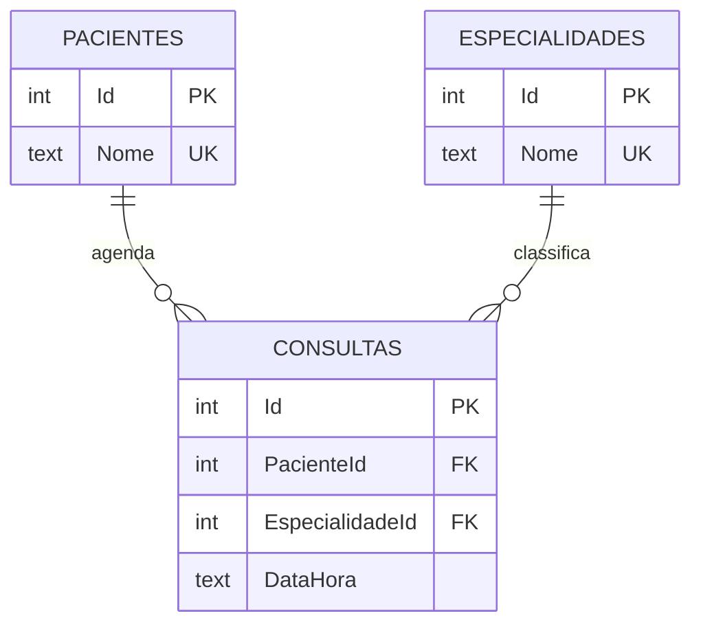

# Tópico 08: persistência e modelagem de dados para web

Este exemplo troca o armazenamento da API do tópico 06. O `ConsultaRepositorioEmMemoria`, que guardava a agenda numa lista, é substituído por `ConsultaRepositorioEf`, que grava em SQLite com Entity Framework Core. A interface `IConsultaRepositorio`, o `ConsultasController`, a rota `/api/consultas` e o JSON com `id`, `paciente`, `especialidade` e `dataHora` permanecem como estavam.

A pasta parte da API do tópico 07 (com CORS), copiada sem alterar os tópicos 06 e 07. A escolha está em `docs/adrs/ADR-006-banco-sqlite-com-ef-core-na-api-do-topico-08.md`. O front do tópico 07 funciona contra esta API sem mudança.

## Modelo relacional

Cada consulta guarda os números do paciente e da especialidade, e os nomes ficam uma vez nas tabelas de apoio.



Restrições definidas no `ClinicaContexto`:

| Restrição | Onde | O que o banco recusa |
|---|---|---|
| Chave primária | `Id` das três tabelas | Duas linhas com o mesmo `Id` |
| Chave estrangeira com `ON DELETE RESTRICT` | `Consultas.PacienteId` e `Consultas.EspecialidadeId` | Consulta de paciente ou especialidade inexistente, e remoção de paciente ou especialidade que ainda tem consulta |
| Única | `Pacientes.Nome` e `Especialidades.Nome` | Nome repetido |
| Única composta | `Consultas (PacienteId, DataHora)` | O mesmo paciente em dois lugares no mesmo horário |

## Arquivos

- `api/ClinicaVida.Api/Entidades/`: `Paciente`, `Especialidade` e `ConsultaAgendada`, uma classe por tabela.
- `api/ClinicaVida.Api/Dados/ClinicaContexto.cs`: o `DbContext`, com as restrições e os dados iniciais (as 3 consultas do tópico 06).
- `api/ClinicaVida.Api/Migrations/`: a migração `Inicial`, gerada com `dotnet ef migrations add Inicial`.
- `api/ClinicaVida.Api/Repositorios/ConsultaRepositorioEf.cs`: a implementação da interface com EF Core.
- `api/ClinicaVida.Api/Repositorios/ConflitoDeAgendaException.cs`: o erro que o repositório lança quando a restrição única recusa a gravação. O `Program.cs` o traduz em 409.
- `api/ClinicaVida.Api/Models/Consulta.cs` e `Controllers/ConsultasController.cs`: iguais aos do tópico 06.
- `api/ClinicaVida.Api.Tests/`: 29 testes. `ConsultasRestTests` (12) e `CorsTests` (4) são os dos tópicos 06 e 07, com a fábrica trocada por `ApiFactory`, que usa SQLite em memória. `ModeloRelacionalTests` (8) e `PersistenciaTests` (5) são novos.
- `consultas/contagem-por-especialidade.sql`: a consulta SQL do Passo 5.
- `requisicoes/*.json`: os corpos usados nos comandos `curl`.

## Pré-requisitos

1. .NET SDK 10.0 ou superior.

   ```bash
   dotnet --version
   ```

   Resultado esperado: um número que começa por `10.`.

2. O cliente `sqlite3`, para abrir o arquivo do banco (vem instalado no macOS e na maioria das distribuições Linux; no Windows, baixe em sqlite.org).

   ```bash
   sqlite3 --version
   ```

   Resultado esperado: um número de versão 3.

3. A ferramenta `dotnet-ef`, só se você for gerar migrações novas. Para rodar o exemplo ela não é necessária.

   ```bash
   dotnet tool install --global dotnet-ef
   ```

   Resultado esperado: a mensagem `A ferramenta 'dotnet-ef' ... foi instalada com êxito`, ou aviso de que já está instalada.

## Como executar

### Passo 1: Testar a API contra o banco

A partir da pasta raiz do repositório:

```bash
dotnet test topico-08-persistencia/ClinicaVida.sln
```

Resultado esperado: `Passed!  - Failed:     0, Passed:    29`. Para ver os grupos separados, use `--filter "FullyQualifiedName~ModeloRelacionalTests"` (8 testes) e o mesmo filtro com `PersistenciaTests` (5), `ConsultasRestTests` (12) e `CorsTests` (4).

### Passo 2: Subir a API e criar o banco

```bash
cd topico-08-persistencia/api/ClinicaVida.Api
dotnet run
```

Resultado esperado: o log mostra `Applying migration '...Inicial'`, os comandos `CREATE TABLE "Especialidades"`, `CREATE TABLE "Pacientes"` e `CREATE TABLE "Consultas"`, e por fim `Now listening on: http://localhost:5084`. O arquivo `clinica.db` aparece na pasta. Se a API do tópico 06 ou 07 estiver aberta, encerre-a antes com `Ctrl+C`.

### Passo 3: Chamar a API

Em outro terminal, a partir da pasta raiz do repositório:

```bash
curl -i http://localhost:5084/api/consultas/2
```

Resultado esperado:

```text
HTTP/1.1 200 OK
Content-Type: application/json; charset=utf-8
Server: Kestrel
Transfer-Encoding: chunked

{"id":2,"paciente":"Bruno Lima","especialidade":"Cardiologia","dataHora":"2026-10-05T10:30:00"}
```

### Passo 4: Criar uma consulta e conferir que ela persiste

```bash
curl -i -X POST -H "Content-Type: application/json" -d @topico-08-persistencia/requisicoes/nova-consulta.json http://localhost:5084/api/consultas
```

Resultado esperado: `HTTP/1.1 201 Created`, o cabeçalho `Location: http://localhost:5084/api/consultas/4` e o corpo com Diego Rocha. Aperte `Ctrl+C` no terminal da API, rode `dotnet run` de novo e repita `curl http://localhost:5084/api/consultas`: a lista volta com 4 consultas, e o log não mostra nenhuma migração aplicada.

### Passo 5: Medir a contagem por especialidade

Com a API encerrada, a partir de `topico-08-persistencia/api/ClinicaVida.Api`:

```bash
sqlite3 -header -column clinica.db < ../../consultas/contagem-por-especialidade.sql
```

Resultado esperado, depois do POST do Passo 4:

```text
especialidade  total
-------------  -----
Cardiologia        2
Clínica geral      1
Dermatologia       1
```

### Passo 6: Ver o banco recusar uma gravação

Ainda em `clinica.db`:

```bash
sqlite3 clinica.db "PRAGMA foreign_keys=ON; DELETE FROM Pacientes WHERE Id=1;"
```

Resultado esperado: `FOREIGN KEY constraint failed`, porque a consulta 1 ainda aponta para o paciente 1. Com a API no ar, repetir o `POST` de Ana Souza às `2026-10-05T09:00:00` devolve `409`.

## Se der errado

### Erro 1: a API não sobe e escreve `address already in use`

A API do tópico 06 ou 07 ainda usa a porta 5084. Encerre-a com `Ctrl+C` e rode `dotnet run` de novo.

### Erro 2: o comando `sqlite3` não é encontrado

O cliente de linha de comando não está instalado. Instale-o pelo gerenciador de pacotes do sistema, ou abra o arquivo `clinica.db` em um visualizador de SQLite. A API e os testes não dependem desse comando.

### Erro 3: o `curl` devolve a lista de uma execução anterior

O arquivo `clinica.db` guarda o estado entre execuções. Para voltar às 3 consultas iniciais, encerre a API, apague `clinica.db` (e `clinica.db-wal` e `clinica.db-shm`, se existirem) e suba de novo.

## Experimente mudar

### Mudança 1: remover a restrição de unicidade do horário

No `ClinicaContexto.cs`, apague a linha do `HasIndex(c => new { c.PacienteId, c.DataHora })`, gere uma migração nova com `dotnet ef migrations add SemUnicidadeDeHorario` e rode `dotnet test`.

Pergunta: qual teste passa a falhar, e que status a API devolve ao repetir o POST de Ana Souza às 09:00?

### Mudança 2: ver as consultas SQL que o EF gera

Rode a API e chame `curl http://localhost:5084/api/consultas`. Procure no log o `SELECT` com `JOIN`.

Pergunta: quantas tabelas aparecem nesse `SELECT`, e onde o nome da especialidade é lido?
